<p align="center">
  <a href="https://overhedge.xyz"></a>
</p>

<h1 align="center">Orca, Overhedge fork</h1>

<p align="center">
  <b>Several Claude subscriptions on one Orca server, one command to move work between them,<br />and your ClickUp tasks inside Orca.</b>
</p>

<p align="center">
  <a href="https://github.com/stablyai/orca/releases/tag/v1.4.278"></a>
  <a href="https://github.com/ferbiy/orca-overhedge/releases/latest"></a>
  
  <a href="https://github.com/ferbiy/orca-clickup-tasks"></a>
  
  <a href="OVERHEDGE.md"></a>
</p>

This is official [Orca](https://github.com/stablyai/orca) plus a small patch, re-applied onto each
upstream release we adopt. It is built for one setup: a headless Orca server that runs a
coordinator chat and its workers on several Claude accounts, for a team that tracks its work in
ClickUp.

**Why**

- **A usage limit no longer stops the team.** Move a coordinator and all its workers to another
  Claude account in one command. Same tabs, same sessions, same history.
- **Pin each chat to the account it should use**, instead of one host-wide account for everything.
- **Drive Orca chats from your phone.** Claude Code Remote Control works in Orca's native chats.
- **Agents on different accounts can talk.** Chats see and message each other across accounts,
  while every account keeps its own login.
- **ClickUp tasks inside Orca.** With our ClickUp plugin, a ClickUp tab on the Tasks page starts a
  task in its own worktree with an agent, or sends it into a chat that is already working.
- **Plugins can do more.** A plugin can add its own tab to the Tasks page and send a message into
  an open chat, on this computer or a paired server.
- **It stays current by itself.** The patch is re-ported onto each new upstream release and
  deployed to our servers at night, when no chat is busy.

<p align="center">
  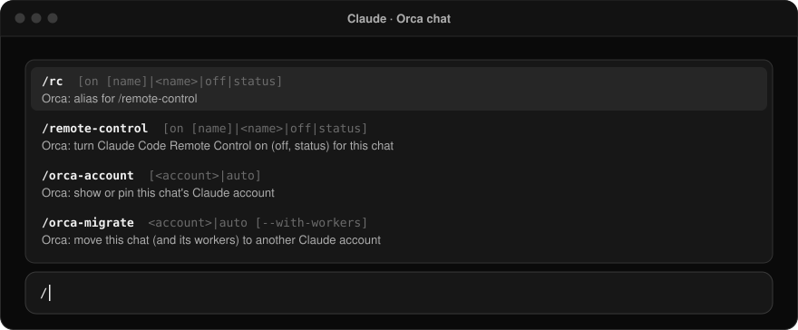
  <br /><sub>Every command is in the chat's slash menu. All mockups use placeholder data.</sub>
</p>

### Move a team of chats to another account

`/orca-migrate` re-pins a chat, and with `--with-workers` every worker it dispatched. Workers move
first and the coordinator last; each chat switches at its next message, after its current turn
ends, in the same tab with the same session and history.

```text
/orca-migrate team@example.com --with-workers
```

<p align="center">
  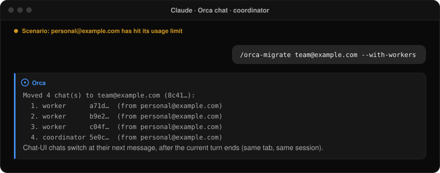
</p>

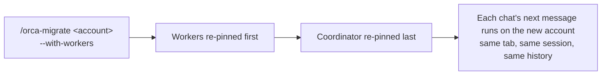

<details>
<summary><b>The same from the CLI</b> (<code>orca account migrate</code>)</summary>

```text
orca account migrate (--to <id|email> | --unpin)
                     (--chat <orca-session-id|terminal:<pane>>... | --with-workers <coordinator-id>... | --all-on <id|email>)
                     [--restart [--timeout <seconds>] [--yes]] [--dry-run] [--json]
```

```bash
orca account migrate --to team@example.com --with-workers 0f3c... --dry-run   # show the plan, change nothing
orca account migrate --to team@example.com --all-on personal@example.com      # everything on one account
orca account migrate --unpin --chat 0f3c...                                   # follow the global account again
```

- Accounts are named exactly: the account id or its full email.
- Terminal Claude tabs are pinned too. Without `--restart` the command prints the line to run in
  each tab after `/exit`. With `--restart` (headless servers only) Orca waits for the turn to end
  and uses upstream's restart-in-place: a new terminal in the same pane resumes the conversation on
  the new account. `--restart` with `--all-on` or `--with-workers` needs `--yes`.

</details>

### Pin a chat to an account

`/orca-account` shows which account a chat uses and why; `/orca-account <id|email>` pins it and
`/orca-account auto` removes the pin. A pinned chat ignores the global account switch. Workers
inherit their coordinator's pin.

```text
/orca-account
/orca-account team@example.com
```

<p align="center">
  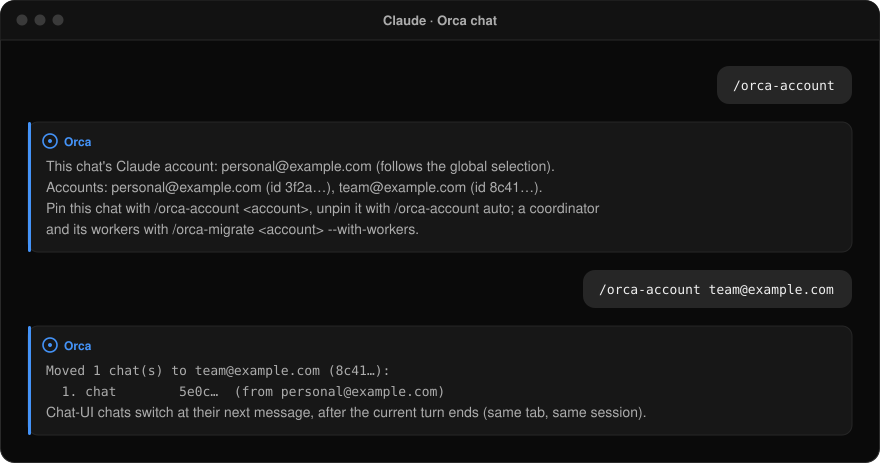
</p>

<details>
<summary><b>Pin at launch</b> (<code>--account</code>)</summary>

The new Claude chat or terminal is pinned before it starts:

```bash
orca agent launch ... --account team@example.com
orca worktree create ... --agent claude --account team@example.com
orca orchestration worker-start ... --account team@example.com
```

This differs from upstream's `orca account select --agent claude --account ...`, which changes
the host-wide selection for every later launch.

</details>

### Remote Control from your phone

`/rc` (or `/remote-control`) turns Claude Code Remote Control on for the chat. Prompts you send from
claude.ai or the Claude phone app show up in the Orca chat together with their replies. If the
chat's Claude process restarts, Remote Control is turned back on.

```text
/rc                  # same as /rc on
/rc on [name]        # or /rc <name>: name the Remote Control session
/rc off
/rc status
```

<p align="center">
  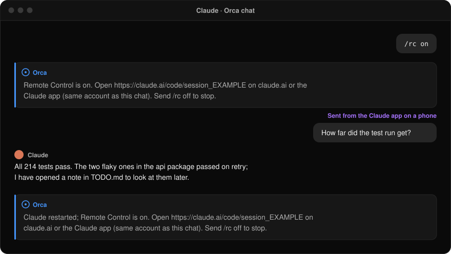
</p>

### Agents on different accounts talk to each other

Claude Code finds its peers through its `sessions` folder. Upstream gives every managed account a
private one, so a chat only sees chats on the same account. The fork links each account's
`sessions` to one shared folder, so every Claude chat or terminal on the host lists and messages
every other one (ListAgents / SendMessage). Only that registry is shared, never credentials.

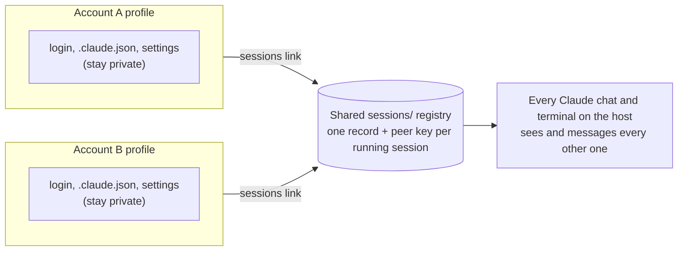

### ClickUp tasks on the Tasks page

Our plugin [ClickUp Tasks](https://github.com/ferbiy/orca-clickup-tasks) (a fork of
[gthjnk/orca-clickup-tasks](https://github.com/gthjnk/orca-clickup-tasks), audited: see its
[SECURITY-AUDIT.md](https://github.com/ferbiy/orca-clickup-tasks/blob/overhedge/SECURITY-AUDIT.md))
brings ClickUp into Orca. On this fork it adds a **ClickUp** tab to the Tasks page, next to
GitHub, GitLab, Linear and Jira.

<p align="center">
  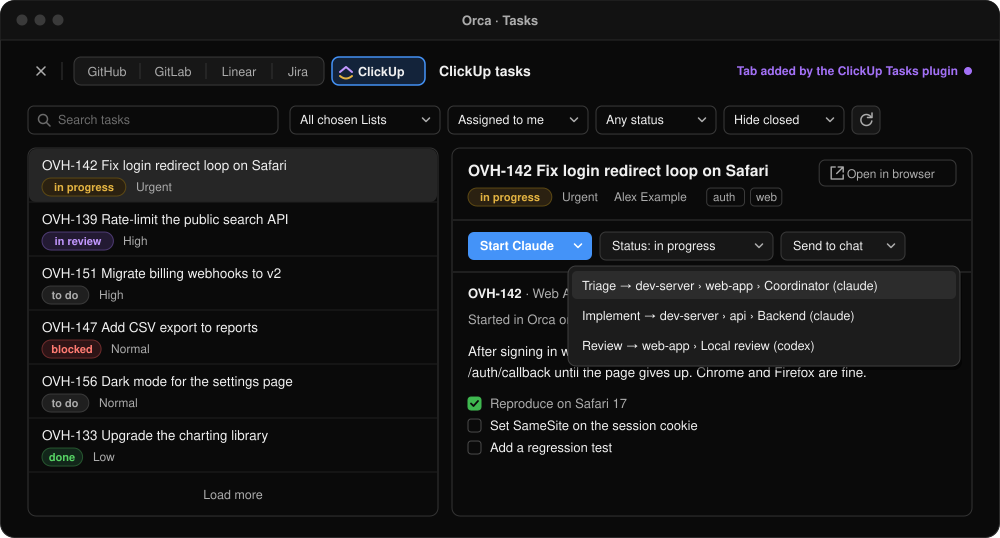
</p>

- **Your tasks, from the Lists you choose.** Sign in with OAuth and pick the Spaces, Folders or
  Lists Orca may see; nothing else is fetched, shown or put into a prompt. Search and filter by
  List, assignee, status and closed.
- **Start ▾** creates a worktree and branch named after the task's custom id (`OVH-142-<slug>`), on
  this computer or a paired server, and starts your agent there with the task as its first prompt.
  By default the task moves to the List's in-progress status.
- **Status ▾** moves the task through the List's own statuses. **Open in browser** opens it in
  ClickUp.
- **List or Board.** Switch the tab to a Kanban board (remembered per tab): one column per status,
  in the List's order and ClickUp's colours, with cards showing the id, title, priority and
  assignees. Drag a card to another column to change its status; it moves at once and goes back if
  ClickUp refuses. With all chosen Lists, statuses of the same name share a column, as on
  ClickUp's own board. Each column has its own **Load more**.
- **Send to chat ▾** hands the task to a chat that is already open (below).

<p align="center">
  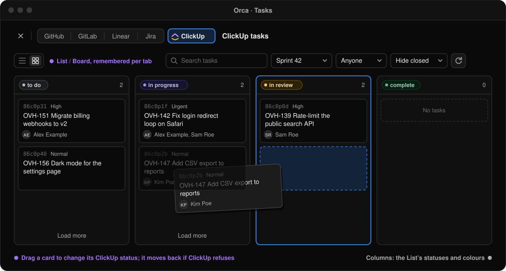
</p>

- **A sidebar panel** has the same tasks with full editing: status, assignees, comments and more.
- Task text is untrusted: in every prompt it sits inside a random fence, marked as data, not
  instructions.
- **For agents in terminals**, the same repo has a small `clickup` command and a Claude Code skill
  ([`agent-cli/`](https://github.com/ferbiy/orca-clickup-tasks/tree/overhedge/agent-cli)), limited
  to an allow-list of Spaces, Folders and Lists.

On stock Orca the plugin's sidebar panel works, but there is no Tasks page tab and no Send to
chat.

### Send a task into a chat that is already working

Save message templates once (Settings, Send to chat), with placeholders such as `{task_url}`,
`{task_id}` and `{title}`. From a task: pick a template, read and edit the filled-in message, pick
an open chat (shown as `server › workspace › chat`), and send. A busy chat takes the message after
its current turn. The chat you used is remembered per template, so the Tasks page menu sends in one
click.

<p align="center">
  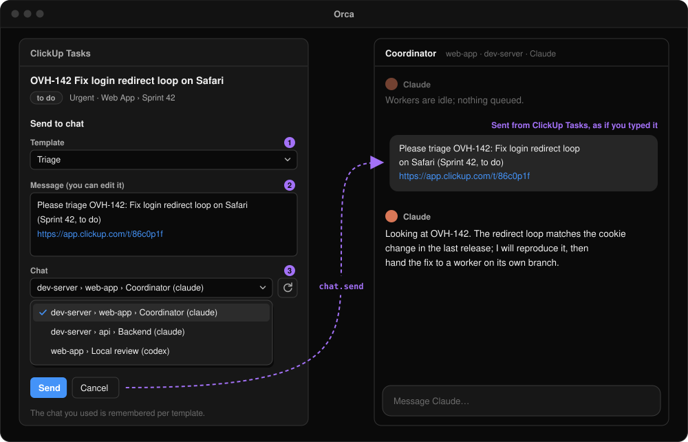
</p>

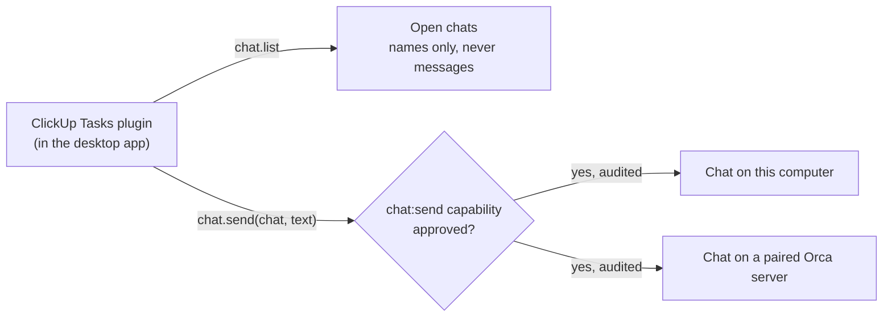

The plugin cannot read messages, open new chats or type into terminals. Every send is in Orca's
plugin audit log.

<details>
<summary><b>For plugin authors</b>: task sources and chat send</summary>

Two small extension points, only in this fork:

- **Task sources.** Declare worker commands `taskSource.<id>.list` (its title is the tab's title),
  and optionally `taskSource.<id>.get` and `taskSource.<id>.action`. The fork turns them into a tab
  on the Tasks page with a list, search, filters, a detail pane and action buttons or menus. Items,
  filters and details use the shapes of upstream PR
  [#26282](https://github.com/stablyai/orca/pull/26282), so moving to upstream's version later
  should be a small change. On stock Orca the same manifest is valid; the commands are just palette
  entries.
- **Chat send.** With the `chat:send` capability, `chat.list({ hostId? })` lists open native chats
  (on this computer and on paired servers) and `chat.send({ chatId, hostId, text })` sends plain
  text into one of them, as the person would type it (at most 4000 characters, never a `/`
  command). Guard with `orca.host.has('chat.send')`; stock Orca does not install a plugin that asks
  for `chat:send`.

The full contract: [OVERHEDGE.md](OVERHEDGE.md), "Plugin task sources" and "Plugin chat send".

</details>

### The same features in the desktop app

The chat and account features live in Orca's main process, which the server and the desktop app
share. Plugins run in the desktop app. So:

| What                       | What you need                                                        | What you get                                     |
| -------------------------- | -------------------------------------------------------------------- | ------------------------------------------------ |
| Chats on a remote server   | the fork's server .deb; the official desktop or mobile app is enough | the chat and account features                    |
| Chats on your own computer | the fork's macOS app                                                 | the same, for local chats                        |
| ClickUp in Orca            | the fork's macOS app and the ClickUp Tasks plugin                    | the Tasks tab; Send to chat, local or on servers |

The chat features are chat commands (listed in the slash menu) and `orca` CLI commands; the only
new desktop UI is a plugin's tab on the Tasks page. Per-chat accounts and migration need
Orca-managed Claude accounts on that machine (Settings, Claude, Add account). On a desktop,
`orca account migrate --restart` prints the resume command instead of restarting the terminal
itself.

The fork's macOS app is ad-hoc signed and never updates itself to an official release, so it keeps
the patch; each new build asks once for keychain access to "Orca Safe Storage" (choose Always
Allow). Linux keeps upstream's updater behavior (a server .deb is updated by hand).

### Left to upstream

Host-wide account switching and restarting running terminal Claude tabs on a switch (Settings,
Claude) are upstream's. `orca account migrate --restart` reuses upstream's restart-in-place.

### How the fork stays current

Upstream releases about every five days. A scheduled job on our build server notices each new
release, re-ports the patch onto it, runs the tests, and builds the server .deb and the macOS app.
It stops and asks a person when upstream changed something the patch relies on, or shipped one of
our features itself. A verified build is deployed to our servers at night, only when no chat is
busy, and rolled back by itself if the new version is not healthy. Each verified build is published
on the [Releases page](https://github.com/ferbiy/orca-overhedge/releases). The macOS app is installed by
hand. The runbook: `docs/overhedge/UPDATE-RUNBOOK.md` on branch `overhedge/ci`.

### Versions, branches and builds

| What                   | Name                                                                                     |
| ---------------------- | ---------------------------------------------------------------------------------------- |
| Patched Orca (default) | branch `overhedge/main`                                                                  |
| Upstream base          | the upstream tag, e.g. `v1.4.278`; each port's head is kept as `overhedge-port/v1.4.278` |
| Releases               | tag `<upstream version>-overhedge.<n>`, e.g. `v1.4.278-overhedge.28`                     |
| CI workflows, tooling  | branch `overhedge/ci`                                                                    |
| Upstream mirror        | branch `main`, unchanged                                                                 |
| Build version          | `<upstream version>+overhedge.<n>.g<sha>`, e.g. `1.4.278+overhedge.28.g7cc005ec10`       |
| Server build           | `orca-ide_<version>+overhedge.<n>.g<sha>_amd64.deb`                                      |
| macOS build            | `Orca-<version>_overhedge.<n>.g<sha>-mac-arm64.zip` (ad-hoc signed)                      |
| Former branches        | tags `archive/overhedge/<name>`, e.g. `archive/overhedge/patch-273`                      |

**Get a build:** download it from the [latest release](https://github.com/ferbiy/orca-overhedge/releases/latest)
(server .deb, macOS zip, `SHA256SUMS`). OVERHEDGE.md explains installing and rolling back.

<details>
<summary><b>Build one yourself</b></summary>

Dispatch a workflow from `overhedge/ci` and point it at a commit of `overhedge/main` (use a full
40-character SHA):

```bash
# Linux server .deb
gh workflow run overhedge-server-deb.yml -R ferbiy/orca-overhedge --ref overhedge/ci -f ref=<sha>
# macOS app (ad-hoc signed, not notarized)
gh workflow run overhedge-mac-app.yml -R ferbiy/orca-overhedge --ref overhedge/ci -f ref=<sha> -f arch=arm64
```

</details>

Details, the overlap with upstream, rollout and how to re-apply the patch on a new release:
[OVERHEDGE.md](OVERHEDGE.md).

<br />

---

<p align="center"><sub><b>Upstream README below</b>, unchanged from <a href="https://github.com/stablyai/orca">stablyai/orca</a>.</sub></p>

<h1 align="center">
  <a href="https://orca.dev"></a> Orca
</h1>

<p align="center">
  <a href="https://github.com/stablyai/orca"></a>
  <a href="https://github.com/stablyai/orca/releases"></a>
  
  <a href="https://discord.gg/fzjDKHxv8Q"></a>
  <a href="https://x.com/orca_build"></a>
  
</p>

<p align="center">
  <sub><a href="docs/readme/README.zh-CN.md">中文</a> · <a href="docs/readme/README.ja.md">日本語</a> · <a href="docs/readme/README.ko.md">한국어</a> · <a href="docs/readme/README.es.md">Español</a> · <a href="docs/readme/README.fr.md">Français</a> · <a href="docs/readme/README.pt.md">Português</a> · <a href="docs/readme/README.tr.md">Türkçe</a> · <a href="docs/readme/README.ru.md">Русский</a></sub>
</p>

<h2 align="center">Bots inside your agent IDE.</h2>

<p align="center">
  Open source. Bring your own everything: your Claude Code or Codex, your local or remote machines, your tools. Ask from Slack or your phone. When it needs you, it's one tab away.
</p>

<h3 align="center"><a href="https://orca.dev/download"><ins>Download Orca</ins></a> &nbsp;·&nbsp; <a href="https://orca.dev/bots"><ins>Explore bots →</ins></a></h3>

<p align="center">
  
</p>

## Features

<table>
<tr>
<td width="50%" valign="middle">

### Orca Bots

Ask a bot in Slack, Linear, or GitHub to fix a bug, and come back to a tested pull request. It runs on your own Claude Code or Codex. Open its work in Orca to review it or step in.

[Overview](https://orca.dev/bots) · [Security](https://orca.dev/docs/bots/security) · [Docs →](https://orca.dev/docs/bots)

</td>
<td width="50%">
  <a href="https://orca.dev/bots"><picture><source srcset="docs/assets/readme-features/bots.webp" type="image/webp"></picture></a>
</td>
</tr>
<tr>
<td width="50%" valign="middle">

### Chat or Terminal

Run any agent in Chat UI or as the raw CLI, and move a conversation between the two without losing context.

[Docs →](https://orca.dev/docs/agents/native-chat)

</td>
<td width="50%">
  <a href="https://orca.dev/docs/agents/native-chat"><picture><source srcset="docs/assets/readme-features/chat-or-terminal.webp" type="image/webp"></picture></a>
</td>
</tr>
<tr>
<td width="50%" valign="middle">

### Orchestrate Agents

Hand a big task to one agent. It splits the work, starts worker agents in their own workspaces, and brings their results back to you.

[Docs →](https://orca.dev/docs/cli/orchestration)

</td>
<td width="50%">
  <a href="https://orca.dev/docs/cli/orchestration"><picture><source srcset="docs/assets/readme-features/orchestration.webp" type="image/webp"></picture></a>
</td>
</tr>
<tr>
<td width="50%" valign="middle">

### Run Anywhere

Pair a Remote Orca Server, work on any SSH host, or give a worktree its own cloud VM. Your agents keep running when your laptop sleeps.

[Docs →](https://orca.dev/docs/ways-to-run)

</td>
<td width="50%">
  <a href="https://orca.dev/docs/ways-to-run"><picture><source srcset="docs/assets/readme-features/remote.webp" type="image/webp"></picture></a>
</td>
</tr>
<tr>
<td width="50%" valign="middle">

### Mobile App

Pair Orca with the mobile app to get pinged when an agent needs you, reply in chat, and keep work moving on any of your machines when you are away from your desk.

[iOS App Store](https://apps.apple.com/us/app/orca-ide/id6766130217) · [Google Play](https://play.google.com/store/apps/details?id=dev.orca.app) · [Android APK](https://orca.dev/download/android) · [Docs →](https://orca.dev/docs/mobile)

</td>
<td width="50%">
  <a href="https://orca.dev/docs/mobile"><picture><source srcset="docs/assets/readme-features/mobile-companion.webp" type="image/webp"></picture></a>
</td>
</tr>
<tr>
<td width="50%" valign="middle">

### Review AI Output

Review diffs, leave notes on exact changed lines, and send focused feedback back to an agent.

[Docs →](https://orca.dev/docs/review/annotate-ai-diff)

</td>
<td width="50%">
  <a href="https://orca.dev/docs/review/annotate-ai-diff"><picture><source srcset="docs/assets/readme-features/annotate-ai-diffs.webp" type="image/webp"></picture></a>
</td>
</tr>
<tr>
<td width="50%" valign="middle">

### Git Integration

Draft commit messages and pull requests from the diff, then send failing checks or PR review comments back to an agent to fix.

[Docs →](https://orca.dev/docs/review/commit-push)

</td>
<td width="50%">
  <a href="https://orca.dev/docs/review/commit-push"><picture><source srcset="docs/assets/readme-features/git-integration.webp" type="image/webp"></picture></a>
</td>
</tr>
<tr>
<td width="50%" valign="middle">

### Parallel Worktrees

Quickly split tasks into isolated environments, so multiple agents can work side by side without interfering with each other.

[Docs →](https://orca.dev/docs/model/worktrees)

</td>
<td width="50%">
  <a href="https://orca.dev/docs/model/worktrees"><picture><source srcset="docs/assets/readme-features/parallel-worktrees.webp" type="image/webp"></picture></a>
</td>
</tr>
<tr>
<td width="50%" valign="middle">

### Design Mode

Click any element in Orca's browser to copy its HTML, styles, and selector, then paste it into your agent's chat.

[Docs →](https://orca.dev/docs/browser/design-mode)

</td>
<td width="50%">
  <a href="https://orca.dev/docs/browser/design-mode"><picture><source srcset="docs/assets/readme-features/design-mode.webp" type="image/webp"></picture></a>
</td>
</tr>
<tr>
<td width="50%" valign="middle">

### GitHub &amp; Linear, Native

See your GitHub and Linear tasks in one place, and start a workspace for each when you're ready to build.

[Docs →](https://orca.dev/docs/review/linear)

</td>
<td width="50%">
  <a href="https://orca.dev/docs/review/linear"><picture><source srcset="docs/assets/readme-features/github-linear-tasks.webp" type="image/webp"></picture></a>
</td>
</tr>
<tr>
<td width="50%" valign="middle">

### Orca CLI

Anything you can do in Orca, your agents can do too: create worktrees, start workers, drive the browser and desktop apps, and schedule automations, all from the command line.

[Docs →](https://orca.dev/docs/cli/overview)

</td>
<td width="50%">
  <a href="https://orca.dev/docs/cli/overview"><picture><source srcset="docs/assets/readme-features/orca-cli.webp" type="image/webp"></picture></a>
</td>
</tr>
<tr>
<td width="50%" valign="middle">

### Plugins

Themes, editors, languages, and panels from the community, installed in a click.

[Browse plugins →](https://orca.dev/plugins)

</td>
<td width="50%">
  <a href="https://orca.dev/plugins"><picture><source srcset="docs/assets/readme-features/plugins.webp" type="image/webp"></picture></a>
</td>
</tr>
<tr>
<td width="50%" valign="middle">

### Split Anything

Put agents, terminals, browsers, and diffs side by side in split panes shaped to the task.

[Docs →](https://orca.dev/docs/model/tabs-panes-splits)

</td>
<td width="50%">
  <a href="https://orca.dev/docs/model/tabs-panes-splits"><picture><source srcset="docs/assets/readme-features/split-anything.webp" type="image/webp"></picture></a>
</td>
</tr>
</table>

**Also in the box:**

- **[Bot Schedules &amp; Triggers](https://orca.dev/docs/bots#put-it-on-a-schedule)**: run a bot every weekday at 9, or when a pull request opens, a check fails, or a webhook fires.
- **[Bot Memory in Markdown](https://orca.dev/docs/bots/security#what-you-can-review)**: a bot's soul and memory are plain Markdown files (`SOUL.md`, `MEMORY.md`) you can read and edit.
- **[Drag Files to Agents](https://orca.dev/docs/editing/file-explorer)**: drag files from the explorer, or images from your desktop, straight into an agent's prompt.
- **[Jump Anywhere](https://orca.dev/docs/model/quick-open)**: one shortcut jumps to any workspace or tab across every repo and host.
- **[Rich Previews](https://orca.dev/docs/editing/viewers)**: open images, PDFs, and Markdown right in the workspace, next to the agent that made them.
- **[Mobile Emulator](https://orca.dev/docs/cli/overview#mobile-emulator)**: run an iOS Simulator or Android emulator beside your agent, and let it tap, type, and check its own work.
- **[Dictation](https://orca.dev/docs/settings#voice)**: press a shortcut and talk. Orca types what you say into the agent's prompt or terminal.
- **[Usage &amp; Accounts](https://orca.dev/docs/agents/usage-tracking)**: see how much of your agent limits you've used and when they reset, and switch accounts without logging out.
- **[Automations](https://orca.dev/docs/cli/automations)**: schedule prompts to run on any repo: nightly dependency bumps, weekly triage, flaky-test sweeps.
- **[Computer Use](https://orca.dev/docs/cli/computer-use)**: when there's no CLI or API, agents can see and drive desktop apps and external browsers.
- **And many, many more**: we ship daily, so this list is perpetually behind. The [changelog](https://github.com/stablyai/orca/releases) is the real feature list.

---

## Supported Agents

Works with **any CLI agent** — if it runs in a terminal, it runs in Orca.

<p>
  <a href="https://docs.anthropic.com/claude/docs/claude-code"><kbd> Claude Code</kbd></a> &nbsp;
  <a href="https://github.com/openai/codex"><kbd> Codex</kbd></a> &nbsp;
  <a href="https://x.ai/cli"><kbd> Grok</kbd></a> &nbsp;
  <a href="https://cursor.com/cli"><kbd> Cursor</kbd></a> &nbsp;
  <a href="https://docs.github.com/en/copilot/how-tos/set-up/install-copilot-cli"><kbd> GitHub Copilot</kbd></a> &nbsp;
  <a href="https://dev.meta.ai/docs/muse-code"><kbd> Muse</kbd></a> &nbsp;
  <a href="https://deepseek-harness.github.io/deepseek-harness/"><kbd> DeepSeek Harness</kbd></a> &nbsp;
  <a href="https://zcode.z.ai/en/docs"><kbd> ZCode</kbd></a> &nbsp;
  <a href="https://opencode.ai/docs/cli/"><kbd> OpenCode</kbd></a> &nbsp;
  <a href="https://mimo.xiaomi.com/coder"><kbd> MiMo Code</kbd></a> &nbsp;
  <a href="https://ampcode.com/manual#install"><kbd> Amp</kbd></a> &nbsp;
  <a href="https://openclaude.gitlawb.com/"><kbd> OpenClaude</kbd></a> &nbsp;
  <a href="https://antigravity.google/docs/cli-overview"><kbd> Antigravity</kbd></a> &nbsp;
  <a href="https://pi.dev"><kbd> Pi</kbd></a> &nbsp;
  <a href="https://omp.sh"><kbd> oh-my-pi</kbd></a> &nbsp;
  <a href="https://hermes-agent.nousresearch.com/docs/"><kbd> Hermes Agent</kbd></a> &nbsp;
  <a href="https://devin.ai/cli"><kbd> Devin</kbd></a> &nbsp;
  <a href="https://goose-docs.ai/docs/quickstart/"><kbd> Goose</kbd></a> &nbsp;
  <a href="https://docs.augmentcode.com/cli/overview"><kbd> Auggie</kbd></a> &nbsp;
  <a href="https://github.com/autohandai/code-cli"><kbd> Autohand Code</kbd></a> &nbsp;
  <a href="https://github.com/charmbracelet/crush"><kbd> Charm</kbd></a> &nbsp;
  <a href="https://docs.cline.bot/cline-cli/overview"><kbd> Cline</kbd></a> &nbsp;
  <a href="https://www.codebuddy.ai/cli"><kbd> CodeBuddy</kbd></a> &nbsp;
  <a href="https://www.codebuff.com/docs/help/quick-start"><kbd> Codebuff</kbd></a> &nbsp;
  <a href="https://freebuff.com"><kbd> Freebuff</kbd></a> &nbsp;
  <a href="https://commandcode.ai/docs/quickstart"><kbd> Command Code</kbd></a> &nbsp;
  <a href="https://docs.continue.dev/cli/quickstart"><kbd> Continue</kbd></a> &nbsp;
  <a href="https://docs.factory.ai/cli/getting-started/quickstart"><kbd> Droid</kbd></a> &nbsp;
  <a href="https://kilo.ai/docs/cli"><kbd> Kilocode</kbd></a> &nbsp;
  <a href="https://www.kimi.com/code/docs/en/kimi-code-cli/getting-started.html"><kbd> Kimi</kbd></a> &nbsp;
  <a href="https://kiro.dev/docs/cli/"><kbd> Kiro</kbd></a> &nbsp;
  <a href="https://github.com/mistralai/mistral-vibe"><kbd> Mistral Vibe</kbd></a> &nbsp;
  <a href="https://github.com/QwenLM/qwen-code"><kbd> Qwen Code</kbd></a> &nbsp;
  <a href="https://support.atlassian.com/rovo/docs/install-and-run-rovo-dev-cli-on-your-device/"><kbd> Rovo Dev</kbd></a> &nbsp;
  <kbd>+ any CLI agent</kbd>
</p>

---

## Install

### Desktop — macOS, Windows, Linux

- **[Download from orca.dev](https://orca.dev/download)**
- Or grab a build directly: [macOS Apple Silicon](https://github.com/stablyai/orca/releases/latest/download/orca-macos-arm64.dmg) · [macOS Intel](https://github.com/stablyai/orca/releases/latest/download/orca-macos-x64.dmg) · [Windows (.exe)](https://github.com/stablyai/orca/releases/latest/download/orca-windows-setup.exe) · [Linux AppImage](https://github.com/stablyai/orca/releases/latest/download/orca-linux.AppImage) · [All builds](https://github.com/stablyai/orca/releases/latest)

_Or via a package manager:_

```bash
# macOS (Homebrew)
# Always use the full name; bare `orca` is an unrelated Plotly cask.
brew install --cask stablyai/orca/orca
# Upgrade an existing install
brew upgrade --cask stablyai/orca/orca
# Release candidates (conflicts with the stable cask; uninstall it first)
brew install --cask stablyai/orca/orca@rc

# Arch Linux (AUR) — or stably-orca-git to build from source
yay -S stably-orca-bin
```

### Mobile App — iOS, Android

Pair with your desktop app to monitor and steer your agents from your phone.

- **iOS:** [Download on the App Store](https://apps.apple.com/us/app/orca-ide/id6766130217)
- **Android:** [Google Play](https://play.google.com/store/apps/details?id=dev.orca.app) · [Download APK](https://orca.dev/download/android) · [Install guide](https://orca.dev/docs/android-apk)

---

## Community &amp; Support

- **Discord:** Join the community on **[Discord](https://discord.gg/fzjDKHxv8Q)**.
- **Twitter / X:** Follow **[@orca_build](https://x.com/orca_build)** for updates and announcements.
- **WeChat:** Scan to join an Orca community WeChat group.

  

- **Feedback &amp; Ideas:** We ship fast. Missing something? [Request a new feature](https://github.com/stablyai/orca/issues).
- **Privacy:** See the [privacy &amp; telemetry docs](https://orca.dev/docs/telemetry) for what anonymous usage data Orca collects and how to opt out.
- **Show Support:** [Star](https://github.com/stablyai/orca) this repo to follow along with our daily ships.

---

## Developing

Want to contribute or run locally? See our [CONTRIBUTING.md](.github/CONTRIBUTING.md) guide.

<a href="https://github.com/stablyai/orca/graphs/contributors">
  
</a>

<p align="center">
  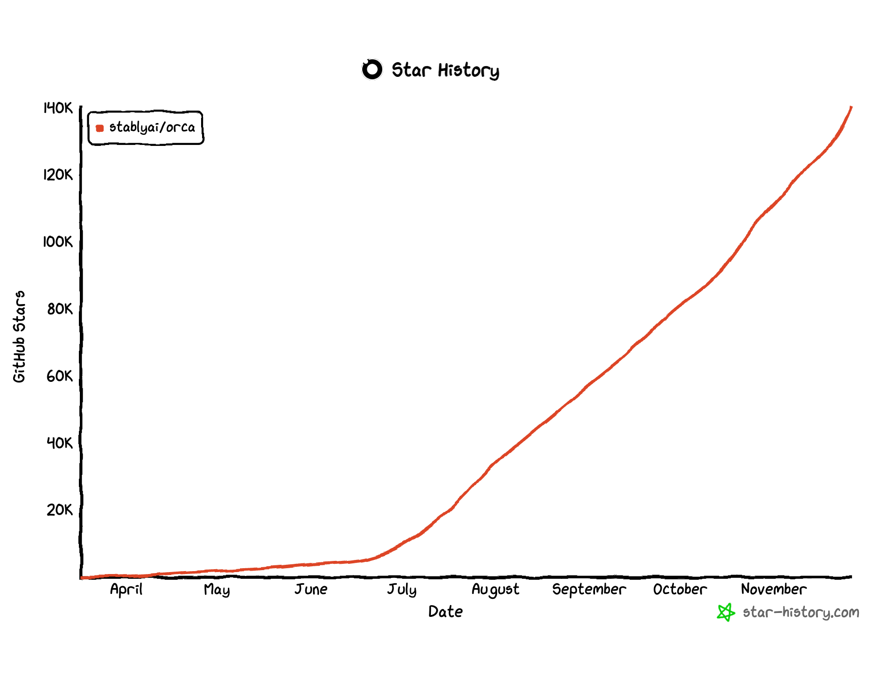
</p>

## Signed Builds

Windows code signing sponsored/provided by [SignPath.io](https://signpath.io), certificate by [SignPath Foundation](https://signpath.org).

## License

Orca is free and open source under the [MIT License](LICENSE).
